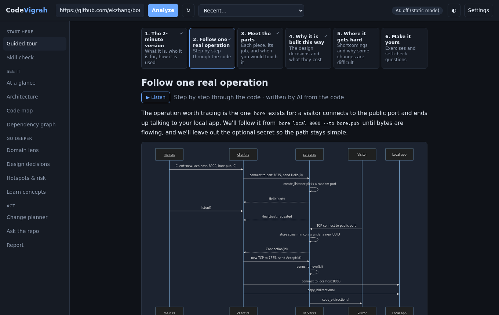
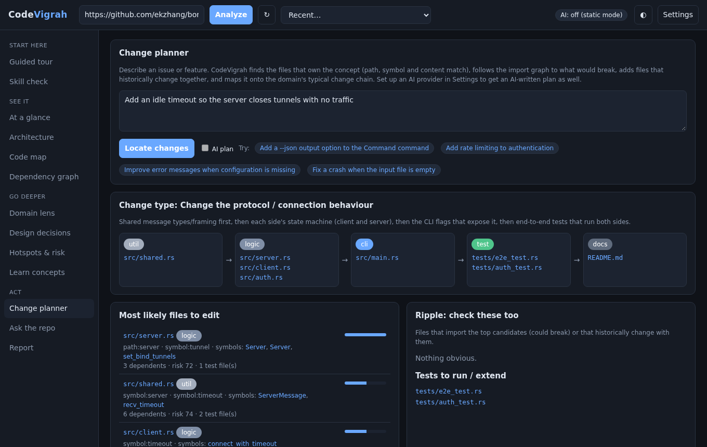

# CodeVigrah

[](https://github.com/samarthpusalkar/CodeVigrah/actions/workflows/ci.yml)
[](LICENSE)


> *vigraha* (विग्रह, said "VIG-ruh"): to split something into its fundamental parts, as in *samāsa-vigraha*, breaking a
> Sanskrit compound word back into the words it was made from. CodeVigrah does that to a codebase, so you can understand it.

**Understand any repository like its author.** Paste a GitHub URL and CodeVigrah gives you a guided tour of the code, its
architecture, the design decisions behind it and what they cost, where changes are risky, and which files an issue would
touch. Then it checks how much you understood.

It runs on anything with Python and git (it was built on a Raspberry Pi). The core needs no packages. AI is optional:
Claude Code, the Anthropic API, a local model through Ollama, or Groq. Without AI, every view still works from static analysis.



## Quick start

```bash
git clone https://github.com/samarthpusalkar/CodeVigrah.git && cd CodeVigrah
./run.sh                       # open http://127.0.0.1:8765 and paste e.g. ekzhang/bore
```

Or install it as a command: `pip install .` (add `".[anthropic]"` for the Anthropic API provider), then run `codevigrah`.

```bash
codevigrah --host 0.0.0.0                          # reachable from your phone or laptop on the same network
codevigrah analyze pallets/click                   # print a plain-language brief in the terminal
codevigrah report expressjs/express -o express.md  # Markdown onboarding report
```

Requirements: Python 3.10+, git, and a modern browser. Linux and macOS are supported; on Windows use WSL.

## What you get

| View | What it is for |
|---|---|
| **Guided tour** | Six short chapters that go progressively deeper: the 2-minute version, one real operation traced through the code, the parts, why it is built this way, where it gets hard, and exercises. Written by AI from the code, with diagrams, cached per commit. **Listen** reads a version rewritten for the ear, with natural voices if you run the speech server ([docs/speech.md](docs/speech.md)). |
| **Skill check** | Three levels (Reader, Contributor, Owner) of multiple-choice questions and "which files would change?" exercises, some from the project's real commits. Results break down by skill and by kind of knowledge (this repo, language, system design, domain). |
| **At a glance** | Brief, languages, frameworks, detected domain with evidence, entry points, recent history, README. |
| **Architecture** | Modules arranged by dependency level, import cycles, a dependency structure matrix, and hidden coupling from git history. |
| **Code map** and **Dependency graph** | Treemap coloured by role, language, risk, churn or age; force-directed import graph. |
| **Domain lens** | For backends, frontends, CLIs, databases, compilers and more: a mental model, what is hard in that domain, and shortcomings with evidence. |
| **Design decisions** | Detected choices (framework, ORM, layering, config, queues…) with *why* they were made and *the cost you inherit*. |
| **Hotspots** | Risk per file from blast radius, churn, complexity, size, cycles and missing tests; knowledge silos. |
| **Change planner** | Describe an issue and get the files to edit, what ripples, which tests, and an optional AI plan. |
| **Ask the repo** | Chat grounded in the analysis and retrieved source excerpts. |
| **Report** | A downloadable Markdown onboarding report. |

Click any file anywhere to open the inspector: role, metrics, who imports it, what it imports, files that change with it,
tests, symbols, the source, and "Explain with AI".



## AI providers

CodeVigrah picks the first available provider and falls back to the next one if it fails.

| Provider | Setup | Notes |
|---|---|---|
| Claude Code | install and log in | Opens files itself with read-only tools. Uses your Claude plan. |
| Anthropic API | `ANTHROPIC_API_KEY`, `pip install "codevigrah[anthropic]"` | Default model `claude-opus-5-5`. |
| Ollama | `CODEVIGRAH_OLLAMA_MODEL=qwen2.5-coder:14b` | Free and private; can run on another machine with a GPU. |
| Groq | `GROQ_API_KEY`, `CODEVIGRAH_GROQ_MODEL` | Hosted open models with a free tier. |
| OpenAI-compatible | `CODEVIGRAH_OPENAI_BASE_URL`, `CODEVIGRAH_OPENAI_MODEL` | LM Studio, vLLM, llama.cpp, OpenRouter, OpenAI… |

Set the order with `CODEVIGRAH_AI_PROVIDERS`, for example `ollama,groq,claude-cli`, or change it in **Settings**.
Details and model suggestions: [docs/ai-providers.md](docs/ai-providers.md).

## Configuration

Everything is optional and comes from environment variables or a `.env` file; copy [`.env.example`](.env.example) to start.
Command-line flags override both. API keys are only read from the environment, are never written to disk by CodeVigrah, and are
never sent to the browser.

## Hosting it for other people

`codevigrah --public` (or `CODEVIGRAH_PUBLIC=1`) locks the AI settings, refuses local folders, and turns on per-visitor rate limits.
Put HTTPS in front with Caddy or a Cloudflare Tunnel. Remember that **you pay for the AI your visitors use**.
See [docs/deployment.md](docs/deployment.md) for a Raspberry Pi service, Docker, and putting it on your own domain.

## Read-aloud

**Listen** never reads the page as written: file paths, code, diagrams and lists are turned into speech, and for tour chapters
the AI writes a listening script (short sentences, spoken signposts, diagrams described in words) while the page keeps the
written text and highlights what is being said. Voices come from your browser, or from a small speech server with natural
Kokoro and Piper voices that runs on the Pi itself (`contrib/speech-server/`). See [docs/speech.md](docs/speech.md).

## Privacy and safety

* **Nothing from an analysed repository is ever executed.** Python is parsed with `ast`, other languages with regular expressions.
  Clones run with git hooks disabled, symlinks checked out as plain files, and no submodules.
* Repository text is sent to an AI provider only when you use an AI feature, and only to the provider you configured.
* The web app sends strict security headers (Content Security Policy, no framing), rejects cross-site requests and
  unexpected `Host` headers, and keeps server file paths out of its responses. See [SECURITY.md](SECURITY.md).

## Limits

* Static heuristics: dynamic imports, dependency-injection containers and reflection are invisible to the import graph.
* Shortcoming probes are leads, not verdicts; each shows its evidence.
* Sized for repositories up to about 6,000 files or 40 MB of text; larger ones are truncated.
* One process, in-memory state: fine for personal use and small sites, not for a horizontally scaled service.

## How it works

```
src/codevigrah/
  analysis/    scan -> roles -> modules -> symbols -> import graph -> PageRank, cycles, levels -> git history -> domain -> rules
  knowledge/   the domain knowledge base, as plain data: signals, decisions (why/cost), probes, recipes, concepts
  retrieval.py BM25 search, change localisation, and context packing for AI prompts
  tour.py, quiz.py, report.py   the guided tour, skill check and Markdown report
  llm/         AI providers behind one interface, with fallback
  speech/      read-aloud: speakable text, AI listening scripts, a client for speech servers
  web/         stdlib HTTP server, JSON API, and the single-page UI (vanilla JS + d3)
```

[docs/architecture.md](docs/architecture.md) explains the design, the repository layout, and how to extend each part.

## Prior art

CodeVigrah borrows ideas, not code, from these tools. Credit where it is due:

| Tool | Idea used here |
|---|---|
| DeepWiki, Google Code Wiki | a generated, readable wiki plus chat for a repository |
| Aider repo map | PageRank-ranked map of files and symbols as AI context |
| Repomix, Gitingest, code2prompt | packing a repository into an AI-friendly context |
| CodeScene, code-maat (Adam Tornhill, *Your Code as a Crime Scene*) | hotspots = complexity × churn, temporal coupling, knowledge silos |
| Structure101, Lattix, NDepend | dependency structure matrices and layering |
| dependency-cruiser, madge, pydeps, import-linter | import graphs and cycle detection |
| Sourcegraph, OpenGrok, Sourcetrail | search-first navigation and an inspector for symbols and files |

Good next steps for more precision: tree-sitter for exact symbols and call graphs, SCIP indexers for references, and Semgrep
rules for deeper shortcoming probes.

## Contributing

Bug reports, ideas and pull requests are welcome. Start with [CONTRIBUTING.md](CONTRIBUTING.md). The easiest first contribution
is a new rule in `src/codevigrah/knowledge/`: every rule is plain data.

## License

[MIT](LICENSE). Third-party components and credits: [THIRD_PARTY_NOTICES.md](THIRD_PARTY_NOTICES.md).
