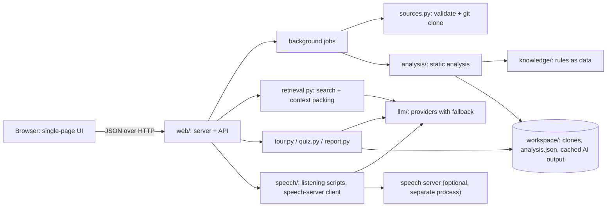

# Architecture

## The big picture



1. **Analyse.** `POST /api/analyze` starts a background job: validate the source, clone it safely, run the analysis pipeline,
   save `analysis.json`, build a search index. The browser polls `/api/job` and then loads the analysis.
2. **Explore.** Most views are drawn in the browser from `analysis.json` alone. The file inspector fetches source on demand.
3. **Ask.** Tour chapters, quizzes, chat, plans and explanations go through `llm.complete()`, which tries providers in order.
   Tour chapters and quizzes are cached per commit and shared by every visitor; the next chapter is generated while you read.

## Repository layout

```
codevigrah/
├── src/codevigrah/            the Python package (the "src layout")
│   ├── __init__.py          version
│   ├── __main__.py, cli.py  `python -m codevigrah` / the `codevigrah` command
│   ├── config.py            settings from environment variables and .env
│   ├── sources.py           input validation, repo ids, safe git clone
│   ├── workspace.py         on-disk layout of analyses and caches
│   ├── service.py           "analyse this source": shared by the CLI and the web server
│   ├── analysis/            the static analysis pipeline, one module per stage
│   ├── knowledge/           the domain knowledge base, as plain data
│   ├── retrieval.py         BM25 search, change localisation, AI context packing
│   ├── tour.py, quiz.py     guided tour and skill check (prompts + static fallbacks)
│   ├── report.py, prompts.py
│   ├── llm/                 one module per AI provider + the router
│   ├── speech/              read-aloud: speakable text, AI listening scripts, speech-server client
│   └── web/                 HTTP server, API endpoints, app state, rate limiter, static UI
├── tests/                   unittest/pytest tests; helpers.py builds a fixture git repo
├── docs/                    documentation for users and contributors
├── deploy/                  examples for systemd and Caddy
├── contrib/speech-server/   optional local text-to-speech server (Kokoro, Piper), in its own venv
├── .github/                 CI workflow, issue and pull request templates, Dependabot
├── pyproject.toml           package metadata, dependencies, entry point, ruff and pytest settings
├── Dockerfile, compose.yaml container image and a hosting setup
├── .env.example             every setting, documented; the real .env is git-ignored
└── README, LICENSE, THIRD_PARTY_NOTICES, CHANGELOG, CONTRIBUTING, SECURITY
```

Why it looks like this:

* **`src/` layout.** The package lives under `src/` so tests run against the code as installed, not against whatever happens to
  be in the current directory. This is the layout the Python Packaging Authority recommends.
* **One module per responsibility.** The analyzer used to be one 1,400-line file; now each stage (scan, symbols, imports,
  manifests, graph, history, entities, domains, rules) is a module you can read on its own. `pipeline.py` shows the order.
* **Layers point one way.** `analysis/` and `knowledge/` know nothing about HTTP or AI. `llm/` knows nothing about repositories.
  `web/` sits on top and wires them together. A change at the top never ripples down, and the lower layers are easy to test.
* **Configuration from the environment** ([twelve-factor](https://12factor.net/config) style): the same code runs on a laptop, a
  Pi and in Docker; secrets never live in the repository.
* **Standard root files** (`README`, `LICENSE`, `CONTRIBUTING`, `SECURITY`, `CHANGELOG`, `.github/`) are where people and GitHub
  look for them: GitHub links them from the repository sidebar and the "new issue" page.

## The analysis pipeline

`analysis/pipeline.py:analyze()` runs these stages and returns one JSON-serialisable dict:

| Stage | Module | Output |
|---|---|---|
| walk files, skip vendored/binary/huge | `scan.py` | path, language, LOC, text |
| classify | `scan.py` | role (route, model, service, ui, cli, test, …) and module |
| symbols and branch complexity | `symbols.py` | Python via `ast`, others via regex; the file's own doc comment |
| imports | `imports.py` | internal import edges for Python, JS/TS (incl. tsconfig paths), Go, Java/Kotlin, Rust, C/C++, Ruby |
| graph | `graph.py` | PageRank, import cycles (Tarjan), module levels |
| history | `history.py` | churn, authors, recency, files that change together |
| entities | `entities.py` | HTTP routes, data models, CLI commands, UI components |
| domain | `domains.py` | backend / frontend / CLI / database / compiler / … with evidence |
| rules | `rules.py` | design decisions, concept cards, shortcoming probes from `knowledge/` |

`SCHEMA` in `pipeline.py` versions the output. Bump it when you add or change fields: analyses saved by an older version are then
re-run automatically from the clone on disk.

## Extending CodeVigrah

* **A new rule** (most common): add an entry to the right file in `knowledge/`. Each rule says *when* it applies (dependency,
  regex, file pattern), *why* the choice is made, and *what it costs* or *why it is hard to fix*.
* **A new language's imports:** add a method to `Resolver` in `analysis/imports.py` and dispatch to it in `Resolver.imports()`.
* **A new AI provider:** see [ai-providers.md](ai-providers.md#adding-a-provider).
* **A new API endpoint:** a function decorated with `@route('POST', '/api/...')` in `web/api.py`. Return a dict for JSON, or
  `Raw(bytes, content_type)` for anything else (audio).
* **A new view:** a file in `web/static/js/views/` that sets `VIEWS.<name> = main => { ... }`, a `<script>` tag in `index.html`
  (before `inspector.js`), and an entry in `NAV` in `js/app.js`.

## The front end

Plain JavaScript with no build step, so it runs from the files as they are. The scripts are classic (non-module) scripts that share
one global scope, loaded in the order listed in `index.html`: `core.js` (state, `$`, `esc`, `api`) → `markdown.js` →
`diagrams.js` → `speech.js` → `app.js` → `views/*.js` → `inspector.js` → `main.js` (wires up the page). A file may use names
defined in files above it.

Everything inserted into the page goes through `esc()` or the Markdown renderer, which escapes HTML. The Content Security Policy
allows scripts only from this site and the two pinned CDN files (with integrity hashes), and forbids inline scripts, so do not add
`onclick="..."` attributes; attach listeners in JavaScript instead.

## Design decisions and their costs

| Decision | Why | Cost |
|---|---|---|
| Standard library only (core) | runs anywhere Python runs, including a Pi; nothing to install or audit | a hand-written HTTP server and `.env` reader; no async |
| Regex parsing outside Python | zero dependencies, fast, good enough for imports and symbols | misses dynamic imports and some edge cases; tree-sitter would be exact |
| One process, in-memory state | simple; caches and jobs need no database | cannot scale horizontally; rate limits reset on restart |
| AI output cached per commit (local folders: per content fingerprint) | popular repositories cost nothing after the first visit | a chapter can be stale if the prompt improves (bump `VERSION` in `tour.py` / `quiz.py`) |
| Classic scripts, no bundler | no toolchain; view source and edit | no modules or types; load order matters |
