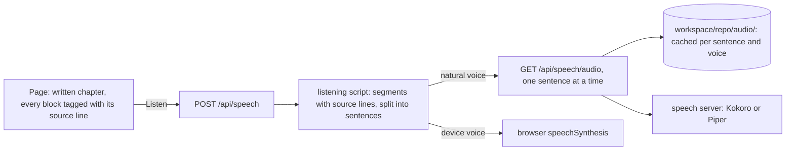

# Read-aloud

Every tour chapter, chat answer, file explanation and report has a **Listen** button. Two things decide how good that sounds:

1. **What is said.** Written text is full of things that work for the eye and fail for the ear: file paths, `path:line`
   references, code blocks, diagrams, parentheses, bullet lists. CodeVigrah never reads the page as it is. It says a
   *listening script* instead.
2. **Who says it.** By default the browser speaks with the voices of the device you are using. On many systems (Chrome or
   Firefox on Linux, for example) that is eSpeak, which sounds robotic. With a **speech server**, natural neural voices are
   made on your own machine instead.

## How it works



* **The page and the voice share line numbers.** `web/static/js/markdown.js` writes the source line of every block into the page
  (`data-ln`), and `speech/text.py` numbers blocks the same way. Whatever is spoken highlights the paragraph it came from,
  even when the words were rewritten. A test runs both parsers on the same text and checks that they agree.
* **Plain reading (no AI).** `speech/text.py` rewrites each block with rules: `src/server.rs:65` becomes "server dot R S",
  `copy_bidirectional` becomes "copy bidirectional", `localhost:8000` becomes "localhost port 8000", arrows become "to",
  parentheses become a spoken aside, and words speech engines get wrong (stdin, CLI, enum, serde…) are respelled. A Mermaid
  diagram is described arrow by arrow, a code block is announced, and a quiz answer is never given away.
* **Listening script (AI).** For tour chapters, `speech/listen.py` asks the AI provider to rewrite the chapter for the ear:
  short sentences, the main point first, spoken signposts ("There are three parts. First, …"), commands said in words, and
  diagrams described like someone pointing at a whiteboard. The model gets the chapter as blocks numbered by source line and
  must answer with the same numbers, so the page can still follow along. Only the voice uses this script: the page keeps the
  written chapter. It is written in the background right after the chapter and cached next to it
  (`tour/<commit>_<version>_<chapter>.listen-<version>.json`). If it is not ready when you press Listen, playback starts with
  the plain reading and switches to the script at the next paragraph. Untick **for listening** in the player to compare.
* **Sentences, not chapters.** Audio is made and cached one sentence (about 200 characters) at a time. The first sentence plays
  after a few seconds, the player fetches the next three while one plays, and replays cost nothing.
* **Only text the server wrote is voiced.** Chat answers, explanations and reports come with a signature (an HMAC with a key
  that lives only in the server process); `/api/speech` refuses any other text. So a public site cannot be used as a free
  text-to-speech service. Fresh sentences are also rate-limited per visitor; cached ones are not.

## Natural voices on a Raspberry Pi

The speech server in [`contrib/speech-server/`](../contrib/speech-server/README.md) runs two engines on the CPU. Measured on a
Raspberry Pi 5 (8 GB):

| Engine and voice | Speed (time to make 1 s of audio) | Quality | License of the voice |
|---|---|---|---|
| Kokoro-82M int8, `af_heart` | 0.73–0.85 s | natural, expressive | Apache-2.0 |
| Piper "high", `en_GB-cori-high` | about 0.7 s | clear, a little flat | public domain (LibriVox) |
| Piper "medium", `en_US-libritts_r-medium` | about 0.1–0.2 s | good, slightly buzzy | CC BY 4.0 (LibriTTS-R) |

Kokoro sounds best but only just keeps up with real-time playback on a Pi. That is fine at 1×, and replays are instant, but the
first listen at 1.5× can pause between sentences. Set `CODEVIGRAH_TTS_PREPARE=1` and the server voices each tour chapter in the
background as soon as its script is ready (a six-chapter tour is about 30 minutes of audio and takes the Pi about 25 minutes, once per commit). Or pick a Piper
"medium" voice in the player, which is several times faster.

```bash
contrib/speech-server/setup.sh       # venv + Kokoro + two Piper voices into ~/.local/share/codevigrah-speech (about 500 MB)
~/.local/share/codevigrah-speech/venv/bin/python contrib/speech-server/speech_server.py --preload af_heart
export CODEVIGRAH_TTS_BASE_URL=http://127.0.0.1:8880/v1
./run.sh
```

To keep it running, install `contrib/speech-server/codevigrah-speech.service` next to `deploy/codevigrah.service`.

## Other speech servers

CodeVigrah speaks the OpenAI-style `POST /v1/audio/speech` API, so the same settings work with:

* **Another machine on your network**, such as a Mac with Apple Silicon running the same speech server (see
  [its README](../contrib/speech-server/README.md#on-a-mac-apple-silicon-for-the-pi-to-use)). List several servers, fastest
  first: `CODEVIGRAH_TTS_BASE_URL=http://my-mac.local:8880/v1,http://127.0.0.1:8880/v1`. One that does not answer is skipped
  for a minute; a server error (5xx) moves on to the next one too.

* **A GPU machine** (such as an RTX box running [Kokoro-FastAPI](https://github.com/remsky/Kokoro-FastAPI) or
  [Speaches](https://speaches.ai)): point `CODEVIGRAH_TTS_BASE_URL` at it. Kokoro on a GPU is many times faster than real time.
  The speech server in `contrib/` also runs there: `pip install onnxruntime-gpu` in its venv and it uses CUDA automatically.
* **OpenAI**: `CODEVIGRAH_TTS_BASE_URL=https://api.openai.com/v1`, `CODEVIGRAH_TTS_API_KEY`, `CODEVIGRAH_TTS_MODEL=gpt-4o-mini-tts`
  and `CODEVIGRAH_TTS_VOICES=alloy,nova,…` (OpenAI has no voice list endpoint). You pay per character.
* **Groq** (Orpheus): `CODEVIGRAH_TTS_BASE_URL=https://api.groq.com/openai/v1`, `CODEVIGRAH_TTS_API_KEY`,
  `CODEVIGRAH_TTS_MODEL=canopylabs/orpheus-v1-english`, `CODEVIGRAH_TTS_VOICES=troy,hannah,austin`, `CODEVIGRAH_TTS_FORMAT=wav`.
  Fast, but in October 2026 its listed limit was 3,600 tokens a day (a few minutes of audio), so it is a demo, not a reader.

Free cloud tiers with enough volume for real use (Google Cloud Text-to-Speech, Azure Speech) need a billing account and their
own API, which CodeVigrah does not speak yet; a provider for them would go in `speech/tts.py`.

## Settings

| Variable | Default | |
|---|---|---|
| `CODEVIGRAH_TTS_BASE_URL` | empty: device voices only | the speech server, e.g. `http://127.0.0.1:8880/v1`; several, comma-separated, fastest first |
| `CODEVIGRAH_TTS_API_KEY` | | sent as `Authorization: Bearer …` |
| `CODEVIGRAH_TTS_MODEL` | `kokoro` | the `model` field of each request |
| `CODEVIGRAH_TTS_VOICE` | the server's first voice | default voice |
| `CODEVIGRAH_TTS_VOICES` | the server's list | comma-separated voices to offer (required for servers without a voice list) |
| `CODEVIGRAH_TTS_FORMAT` | `mp3` | `mp3`, `opus`, `aac`, `flac` or `wav` |
| `CODEVIGRAH_TTS_TIMEOUT` | `120` | seconds per sentence |
| `CODEVIGRAH_TTS_CONCURRENCY` | `1` | sentences voiced at the same time (raise it for a GPU server) |
| `CODEVIGRAH_TTS_PREPARE` | `0` | voice tour chapters in the background with the default voice |
| `CODEVIGRAH_LISTEN_SCRIPTS` | `1` | AI listening scripts for tour chapters (one extra AI call per chapter, cached per commit) |
| `CODEVIGRAH_RATE_TTS_PER_HOUR` | `600` when public, else unlimited | fresh sentences per visitor per hour |

## Privacy

* With a speech server, the text and the audio stay on the machines you run.
* Device voices run in the browser. Some of them are online voices: in Chrome, the voices named "Google …" send the text to
  Google, and Edge's "… Online (Natural)" voices send it to Microsoft. Local voices (eSpeak, most macOS and Windows voices) do not.

## Licenses

The speech server is a separate program in its own virtual environment; CodeVigrah talks to it over HTTP and does not import
it. That keeps CodeVigrah's code MIT-licensed and free of dependencies. The server's dependencies have their own licenses:
`kokoro-onnx` (MIT), Kokoro-82M weights (Apache-2.0), espeak-ng through `espeakng-loader` and `piper-tts` (GPL-3.0). Each Piper
voice was trained on a dataset with its own license, written in its `MODEL_CARD`; `setup.sh` installs only voices with
permissive licenses. Some popular Piper voices (`ryan`, `hfc_female`) are non-commercial only (CC BY-NC-SA).
